# India GCC Regulatory Conflict Register (GDPR x EU AI Act x DPDPA)
## A Machine-Readable Cross-Border Governance Toolkit & Technical Resolution Architecture

[](./LICENSE)
[%202024%2F1689-green.svg)](./conflict_register.json)
[%202016%2F679-orange.svg)](./docs/scc_selection_guide.md)
[](./docs/dpia_template_module.md)
[-success.svg)](./README.md)

**Author:** Vasu Sharma | HealthTech AI Governance Strategist  
**Target Architecture:** Cross-Border European Health Data Pipelines & Indian Global Capability Centers (GCCs)  
**Governing Transfer Instrument:** Commission Implementing Decision (EU) 2021/914 (SCC Modules 2 & 3)  
**Project Type:** Independent Portfolio Project | Open Source HealthTech AI Governance Initiative  

---

## 1. Executive Summary & The Problem Space

European HealthTech and MedTech enterprises increasingly route telemetry monitoring, clinical data annotation, model training, and diagnostic inference pipelines through Indian Global Capability Centers (GCCs) in Bengaluru, Hyderabad, and Pune.

Standard enterprise compliance treat the **European Union General Data Protection Regulation (GDPR)**, the **EU Artificial Intelligence Act (Regulation (EU) 2024/1689)**, and the **India Digital Personal Data Protection Act, 2023 (DPDPA)** as parallel frameworks that can simply be checked off in side-by-side matrices.

In practice, for an Indian GCC processing European patient data, these three frameworks actively collide in specific, legally irreconcilable ways:

1. **The Remote Access Fallacy:** GCC engineering teams frequently assume that viewing European diagnostic imaging over a Virtual Desktop Infrastructure (VDI) or cloud console without downloading files locally does not constitute a "cross-border transfer." Under CJEU *Schrems II* (Case C-311/18) and EDPB Guidelines 05/2021, **remote access from a third country is legally identical to a physical data transfer**.
2. **The Parent BCR Failure Trap:** GCC leadership frequently assumes that the European parent company's Binding Corporate Rules (BCRs) automatically legitimize Indian data operations. In corporate law, an Indian GCC is an independent Private Limited subsidiary incorporated under the Indian Companies Act, 2013. Unless the Indian legal entity has formally acceded to the intra-group BCR agreement approved by the competent EU lead Supervisory Authority, **parent BCRs provide zero legal protection**.
3. **The Adequacy Vacuum:** India does not possess an EU adequacy decision under GDPR Article 45. Consequently, every pipeline routing EU patient data to India requires **appropriate safeguards under GDPR Article 46**, specifically the 2021 modular Standard Contractual Clauses (SCCs), accompanied by a mandatory Transfer Impact Assessment (TIA).
4. **The Retention vs. Erasure Collision:** GDPR Article 17 grants European patients an absolute right to erasure. Concurrently, EU AI Act Article 12 mandates automated, tamper-evident logging of high-risk AI operations retained for a minimum of 6 months (and up to 10 years for technical documentation under Article 18). An engineering team cannot simultaneously delete and retain the same record without a formal technical reconciliation architecture.

This open-source toolkit provides the first machine-readable, mathematically grounded resolution architecture designed specifically for cross-border European-Indian HealthTech operations.

---

## 2. Toolkit Architecture & Core Deliverables

This repository packages 7 production-grade governance assets:

| # | Toolkit Deliverable | Format | Operational Scope & Enterprise Objective |
|---|---|---|---|
| 1 | [`conflict_register.json`](./conflict_register.json) | JSON Schema (34KB) | 17 Mapped Statutory Collisions (GRC-Importable JSON Schema) |
| 2 | [`scc_selection_guide.md`](./docs/scc_selection_guide.md) | Markdown | SCC Decision Tree, Clause Adaptations & TIA Protocol |
| 3 | [`data_flow_architecture.mermaid`](./diagrams/data_flow_architecture.mermaid) | Mermaid Diagram | End-to-End Cross-Border Patient Pipeline Trace |
| 4 | [`dpia_template_module.md`](./docs/dpia_template_module.md) | Markdown | Dual-Regime GDPR Art. 35 x DPDPA Sec. 10 DPIA Module |
| 5 | [`model_governance_card.yaml`](./schemas/model_governance_card.yaml) | YAML Schema | Clinical AI Model Registry & Article 12 Logging Schema |
| 6 | [`enforcement_precedent_appendix.md`](./docs/enforcement_precedent_appendix.md) | Markdown | 8 Empirical Regulatory Enforcement Cases (CJEU/EDPB/CNIL) |
| 7 | [`GDPR_DPDPA_TOCO_Matrix-latest.xlsx`](./data/GDPR_DPDPA_TOCO_Matrix-latest.xlsx) | Excel Workbook | Master Authoring Workbook (3 Clean Validated Tabs) |

### Detailed Deliverable Breakdown:

* **1. [`conflict_register.json`](./conflict_register.json):**  
  A 34KB enterprise JSON schema mapping 17 statutory collisions across GDPR, DPDPA, and the EU AI Act. Each record details statutory articles, operational tensions, technical resolution architectures, applicable SCC modules, residual risks, and enforcement precedents. Ready for direct import into GRC platforms (OneTrust, ServiceNow IRM, MetricStream).
* **2. [`scc_selection_guide.md`](./docs/scc_selection_guide.md):**  
  Operational guidance and structured decision tree mapping Commission Implementing Decision (EU) 2021/914 (Modules 1-4). Details specific clinical AI adaptations for Clauses 8.1, 8.5, 8.8, 9, 14, and 15, an Indian TIA surveillance analysis (IT Act Sec. 69 / CERT-In Directions), and 3 practitioner interview defense scripts.
* **3. [`data_flow_architecture.mermaid`](./diagrams/data_flow_architecture.mermaid):**  
  End-to-end system architecture tracing patient data from Point of Care (Munich University Hospital) through the Frankfurt cloud boundary, cross-border transmission to Bengaluru GCC, AI model inference, WORM audit logging, and the clinical return path with mandatory human oversight (EU AI Act Art. 14 / GDPR Art. 22).
* **4. [`dpia_template_module.md`](./docs/dpia_template_module.md):**  
  Dual-regime Data Protection Impact Assessment template operationalizing GDPR Art. 35 and India DPDPA Section 10 Significant Data Fiduciary obligations into an integrated, modular compliance artifact.
* **5. [`model_governance_card.yaml`](./schemas/model_governance_card.yaml):**  
  Reusable enterprise model governance card and registry schema covering model identity, clinical risk classification, training cohort demographic representation (EU AI Act Art. 10), technical TOMs, and automated logging schemas (Art. 12).
* **6. [`enforcement_precedent_appendix.md`](./docs/enforcement_precedent_appendix.md):**  
  Empirical case repository analyzing 8 landmark rulings and regulatory actions (CJEU *Schrems II*, Meta EUR 1.2B fine, CNIL 101 complaints, TikTok EUR 345M, Doctolib cloud hosting, Criteo EUR 40M, Clearview AI EUR 30.5M, Garante EUR 79.1M).
* **7. [`GDPR_DPDPA_TOCO_Matrix-latest.xlsx`](./data/GDPR_DPDPA_TOCO_Matrix-latest.xlsx):**  
  The underlying multi-tab authoring workbook containing the raw statutory baseline mapping, conflict taxonomy, and currency assumptions.


---

### 2.1 Interactive Cross-Border Clinical Data Flow Architecture

The end-to-end data processing workflow across jurisdictional boundaries is illustrated below:

```mermaid
%% ============================================================================
%% PROJECT 3: INDIA GCC REGULATORY CONFLICT REGISTER
%% Cross-Border Data Flow Architecture & Statutory Governance Trace
%% Author: Vasu Sharma | HealthTech AI Governance Strategist
%% Regimes: EU GDPR (2016/679) x EU AI Act (2024/1689) x India DPDPA 2023
%% Transfer Instrument: Commission Implementing Decision (EU) 2021/914 (SCC Module 2)
%% Standards: Strict 7-bit ASCII, CJEU Schrems II, EDPB Rec 01/2020
%% ============================================================================

flowchart TD

    %% ------------------------------------------------------------------------
    %% SUBGRAPH 1: POINT OF CARE (EUROPEAN UNION)
    %% ------------------------------------------------------------------------
    subgraph JURISDICTION_EU_HOSPITAL ["JURISDICTION 1: POINT OF CARE -- GERMANY (EU)"]
        direction TB
        
        POC_INTAKE["1.0 Clinical Intake & PACS Acquisition\n[Munich University Hospital]\n- Patient Admission & Vital Triage\n- DICOM CT/MRI Scan Ingestion\n* Basis: GDPR Art. 6(1)(e) & Art. 9(2)(h)\n* Standard: Special Category Health Data"]
        
        POC_CONSENT["1.1 Privacy Transparency Engine\n- Patient Notice & Information Disclosure\n- Dual Regime Notice Framework\n* Basis: GDPR Art. 13/14 Transparency\n* Benchmark: DPDPA 2023 Sec. 5 Notice Alignment"]
        
        POC_INTAKE --> POC_CONSENT
    end

    %% ------------------------------------------------------------------------
    %% SUBGRAPH 2: EU SECURE CLOUD GATEWAY & BOUNDARY CONTROLS
    %% ------------------------------------------------------------------------
    subgraph JURISDICTION_EU_CLOUD ["JURISDICTION 1 (CONT.): SECURE INGESTION GATEWAY -- FRANKFURT (EU)"]
        direction TB
        
        EU_APIGW["2.0 EU Cloud Edge API Gateway\n[Frankfurt AWS/Azure Region: eu-central-1]\n- Mutual TLS 1.3 Endpoint Encryption\n- Ephemeral Ingestion Buffer\n* Basis: GDPR Art. 32(1)(a) Security of Processing"]
        
        EU_TOKENIZER["2.1 Tokenization & De-Identification Engine\n- Direct Identifiers Stripped (Name, MRN, National ID)\n- High-Entropy UUID Pseudonyms Generated\n- High-Dimensional Clinical Feature Extraction\n* Basis: GDPR Art. 4(5) & Art. 25 Privacy by Design"]
        
        EU_HSM["2.2 European Key Management Vault\n[FIPS 140-3 Level 3 Dedicated EU HSM]\n- Master AES-256 Encryption Keys Held Exclusively in EU\n- Isolated Token Mapping Lookup Vault\n* Safeguard: EDPB Recommendations 01/2020 Use Case 1\n* Zero Key Access Granted to Indian Legal Entity"]
        
        EU_APIGW --> EU_TOKENIZER
        EU_TOKENIZER <--> EU_HSM
    end

    %% ------------------------------------------------------------------------
    %% SUBGRAPH 3: TRANS-BORDER TRANSFER & CONTRACTUAL INTERFACE
    %% ------------------------------------------------------------------------
    subgraph TRANSFER_INTERFACE ["CROSS-BORDER STATUTORY TRANSFER CHANNEL"]
        direction TB
        
        SCC_CHANNEL["3.0 Article 46 Restricted Transfer Channel\n[Frankfurt, EU -> Bengaluru, India]\n* Primary Instrument: SCC Module 2 (Controller-to-Processor)\n  Commission Implementing Decision (EU) 2021/914\n* Statutory Basis: GDPR Art. 44 & 46(2)(c)\n* Indian Inward Basis: DPDPA 2023 Sec. 16(1) Whitelist\n* Local Indian Exemption: DPDPA Sec. 17(1)(c) Foreign Data\n* TIA Validation: Clause 14 Assessment (Schrems II)\n* Access Paradigm: Remote VDI Display Only (No File Download)"]
    end

    %% ------------------------------------------------------------------------
    %% SUBGRAPH 4: INDIAN GCC PROCESSING & AI EXECUTION LAYER
    %% ------------------------------------------------------------------------
    subgraph JURISDICTION_INDIA_GCC ["JURISDICTION 2: INDIAN GCC SUBSIDIARY -- BENGALURU (INDIA)"]
        direction TB
        
        GCC_VDI["4.0 Zero-Persistence Virtual Desktop (VDI)\n[Bengaluru GCC Engineering Center]\n- Ephemeral Compute Instances in Isolated VPC\n- Disabled Local Clipboard, PrintScreen & Drive Mapping\n- Session RAM Purged on Disconnect\n* TOM: EDPB Supplementary Measure 1"]
        
        GCC_INFERENCE["4.1 High-Risk AI Inference Pipeline\n[Diagnostic Triage & Anomaly Detection Model]\n- Multi-Modal Imaging Tensor Processing\n- Emergency Triage Score Calculation\n* Classification: EU AI Act Annex III Point 5 (High-Risk)\n* MDR Benchmark: Medical Device Software Class IIa\n* Mandate: EU AI Act Art. 10 Bias & Data Quality"]
        
        GCC_TRAINING["4.2 Model Drift & Validation Sandbox\n- Demographic Subgroup Accuracy Verification\n- Model Weights Fine-Tuning\n* Contractual Bound: SCC Clause 8.1(a) (Instructions Only)\n* Data Restriction: Zero Re-Use for GCC R&D Assets\n* Mandate: EU AI Act Art. 10(3) Demographic Parity"]
        
        GCC_VDI --> GCC_INFERENCE
        GCC_VDI --> GCC_TRAINING
    end

    %% ------------------------------------------------------------------------
    %% SUBGRAPH 5: AUDIT, LOGGING & REGULATORY RECONCILIATION
    %% ------------------------------------------------------------------------
    subgraph AUDIT_RECONCILIATION ["TRANS-JURISDICTIONAL AUDIT & RECONCILIATION HUB"]
        direction TB
        
        LOG_ENGINE["5.0 Automated Operational Logging Engine\n- Model Input Feature Hashes & Checksums\n- Inference Timestamp & Algorithmic Probability Output\n- System Operating Parameters & Drift Metrics\n* Mandate: EU AI Act Art. 12(1) Automated Lifecycle Logging\n* Incident Ready: CERT-In 2022 & GDPR Art. 33 Log Trail"]
        
        LOG_RECONCILE["5.1 Collision Reconciliation Service\n[Conflict CR-02 Resolution Architecture]\n- Conflict: GDPR Art. 17 Erasure vs AI Act Art. 12 Retention\n- Legal Exception: GDPR Art. 17(3)(b) Legal Obligation\n- Shreds Direct Subject Identifiers Permanently\n- Retains Pseudonymized Operational Logs in WORM Store\n* Retention Window: 6 Months (Art. 12) to 10 Years (Art. 18)"]
        
        WORM_STORE["5.2 European WORM Audit Archive\n[Immutable Write-Once-Read-Many Cloud Storage]\n- Physically Located in Frankfurt EU Region\n- Cryptographic Proof of Algorithmic Traceability\n* Mandate: EU AI Act Art. 18 Technical Documentation\n* Access: EU Notified Bodies & Supervisory Authorities"]
        
        LOG_ENGINE --> LOG_RECONCILE
        LOG_RECONCILE --> WORM_STORE
    end

    %% ------------------------------------------------------------------------
    %% SUBGRAPH 6: CLINICAL RETURN PATH & HUMAN-IN-THE-LOOP OVERSIGHT
    %% ------------------------------------------------------------------------
    subgraph RETURN_OVERSIGHT ["CLINICAL RETURN STREAM & HUMAN OVERSIGHT -- MUNICH (EU)"]
        direction TB
        
        RETURN_STREAM["6.0 Encrypted Diagnostic Result Payload\n[Bengaluru -> Frankfurt]\n- Triage Priority Score & Bounding Box Coordinates\n- Algorithmic Confidence Metrics\n* Contractual Basis: SCC Clause 8.5 (Service Return)\n* Data Form: Pseudonymized High-Dimensional Tensors"]
        
        EU_DETOKEN["6.1 EU Re-Identification & Assembly Layer\n[Frankfurt Cloud Boundary]\n- UUID Pseudonyms Re-Mapped via EU HSM Lookup\n- Diagnostic Overlay Assembled into Hospital PACS\n* Security: Re-Identification Occurs Exclusively in EU"]
        
        CLINICAL_HITL["6.2 Attending Physician Clinical Review\n[Munich Hospital Emergency / Radiology Suite]\n- Radiologist Inspects AI Triage Heatmap & Score\n- Mandatory Human Affirmative Sign-Off\n- Final Clinical Decision Execution\n* Mandate: EU AI Act Art. 14(4) Human Oversight\n* Safeguard: GDPR Art. 22(1) Automated Decision Protection"]
        
        RETURN_STREAM --> EU_DETOKEN
        EU_DETOKEN --> CLINICAL_HITL
    end

    %% ------------------------------------------------------------------------
    %% INTER-SUBGRAPH WORKFLOW CONNECTIONS
    %% ------------------------------------------------------------------------
    POC_CONSENT -->|"Encrypted DICOM & EHR Stream\n[TLS 1.3 / GDPR Art. 6/9]"| EU_APIGW
    
    EU_TOKENIZER -->|"Tokenized Clinical Dataset\n[Direct IDs Stripped]"| SCC_CHANNEL
    
    SCC_CHANNEL -->|"Authorized VDI Display Stream\n[SCC Module 2 / EDPB TOM 1]"| GCC_VDI
    
    GCC_INFERENCE -->|"Automated Operational Event Stream\n[Inference Telemetry]"| LOG_ENGINE
    
    GCC_TRAINING -->|"Validation Performance Hashes\n[Accuracy & Drift Logs]"| LOG_ENGINE
    
    GCC_INFERENCE -->|"Inference Predictions\n[Scores & Bounding Boxes]"| RETURN_STREAM
    
    CLINICAL_HITL -.->|"Clinician Confirmation / Override Log\n[Art. 14(4) Human-in-the-Loop Event]"| LOG_ENGINE

%% ============================================================================
%% END OF MERMAID ARCHITECTURE SPECIFICATION
%% ============================================================================
```



---

## 3. The 17 Statutory Collisions Summary

The conflict register resolves 17 cross-border legal collisions across three distinct structural categories:

| Collision ID | Conflict Title | Statutory Collision | Resolution Architecture Summary | Primary SCC Module |
| :-- | :-- | :-- | :-- | :-- |
| **CR-01** | Remote Access as Statutory Transfer | GDPR Art. 44 vs DPDPA s.16 | Zero local persistence VDI; remote view classified as Chapter V transfer | Module 2 (C2P) |
| **CR-02** | Right to Erasure vs. Algorithmic Log Retention | GDPR Art. 17 vs AI Act Art. 12 vs DPDPA s.12 | GDPR Art. 17(3)(b) exemption; decoupled WORM telemetry log preservation | Module 2 (C2P) |
| **CR-03** | Third-Country Transfer Adequacy Vacuum | GDPR Art. 45/46 vs DPDPA s.16(1) | Module 2/3 SCC execution + Clause 14 TIA + Split-key HSM encryption | Module 2 / 3 |
| **CR-04** | Mandatory DPIA vs. Local Fiduciary Discretion | GDPR Art. 35 vs DPDPA s.10(2)(c)(i) | Integrated Dual-Regime DPIA module standardizing to strictest EU benchmark | Module 2 (C2P) |
| **CR-05** | DPO Mandate vs. Resident Grievance Officer | GDPR Art. 37 vs DPDPA s.10(2)(a) | Dual-tier governance: EU Group DPO sets policy; India Officer manages local SLAs | Module 2 (C2P) |
| **CR-06** | Demographic Representation vs. Data Minimization | EU AI Act Art. 10(3) vs GDPR Art. 5(1)(c) | Synthetic data generation + multi-site federated validation pipelines | Module 2 (C2P) |
| **CR-07** | Dual Processor / Deployer Accountability Gap | GDPR Art. 28 vs EU AI Act Art. 26 | Tripartite Master Services Agreement aligning processor and deployer duties | Module 2 / 3 |
| **CR-08** | Incompatible Security Breach Notification Windows | GDPR Art. 33 (72h) vs CERT-In (6h) | Unified 4-hour internal escalation SLA triggering dual statutory notices | Module 2 (C2P) |
| **CR-09** | Special Category Health Data vs. Indian SDF Scope | GDPR Art. 9 vs DPDPA s.10 | Direct identifiers severed at EU edge; GCC receives pseudonymized tensors | Module 2 (C2P) |
| **CR-10** | Third-Country Surveillance vs. Confidentiality | GDPR Art. 32 vs IT Act s.69 / DPDPA s.17 | Cryptographic key isolation: Master keys held exclusively in Frankfurt HSM | Module 2 (C2P) |
| **CR-11** | Sub-Processor Contracting and Authorization | GDPR Art. 28(2) vs DPDPA s.8(2) | Mandatory 30-day prior written controller notice + sub-processor flow-down | Module 3 (P2P) |
| **CR-12** | Model Weight Extraction and Trade Secret Protection | GDPR Art. 15 vs EU AI Act Art. 13 vs DPDPA s.11 | High-level model cards and clinical explanations without exporting weights | Module 2 (C2P) |
| **CR-13** | Algorithmic Bias Testing on Sensitive Attributes | EU AI Act Art. 10(5) vs GDPR Art. 9 | Art. 10(5) derogation sandbox: Isolated bias audits with synthetic masking | Module 2 (C2P) |
| **CR-14** | Cross-Border Discovery and Government Demands | SCC Clause 15 vs IT Act s.69 | Contractual commitment to notify controller and exhaust legal challenges | Module 2 (C2P) |
| **CR-15** | Split-Key Cryptographic Governance | GDPR Art. 32 vs DPDPA s.8(5) | Envelope encryption: EU controller holds root key; GCC holds micro-tokens | Module 2 (C2P) |
| **CR-16** | Automated Decision-Making & Human Oversight | GDPR Art. 22 vs EU AI Act Art. 14 | Delayed-Reveal UI architecture: Mandatory attending clinician veto gate | Module 2 (C2P) |
| **CR-17** | Secondary Research Re-Use Restrictions | GDPR Art. 5(1)(b) vs DPDPA s.6 | Contractual ban: GCC prohibited from training proprietary commercial models | Module 2 (C2P) |

---

## 4. The 3 Non-Negotiable Technical Safeguards (TOMs)

To satisfy CJEU *Schrems II* and validate SCC Clause 14, every cross-border HealthTech pipeline must implement three non-negotiable architectural controls:

| Safeguard Layer | Technical Control Architecture | Implementation & Enforcement Specification |
|---|---|---|
| **TOM-01: Zero Local Persistence** | VDI Display Only | Access restricted strictly to Virtual Desktop Infrastructure (Citrix / AWS WorkSpaces); local download, print screen, clipboard copying, and USB mounting disabled at OS level; telemetry processed in ephemeral cloud compute nodes that purge RAM upon disconnect. |
| **TOM-02: Split-Key Cryptography** | Bring Your Own Key (BYOK) | Personal clinical datasets encrypted at rest (AES-256) and in transit (TLS 1.3); master encryption keys held exclusively in a Frankfurt FIPS 140-3 Level 3 Dedicated HSM; Indian GCC possesses zero cryptographic ability to decrypt raw patient records independently. |
| **TOM-03: Edge Pseudonymization** | Tokenization at EU Intake | Direct identifiers (Name, DOB, MRN, National ID) stripped inside EU boundary before transit; high-entropy UUID tokens generated; mapping lookup tables retained exclusively in Frankfurt; Indian GCC processes only high-dimensional clinical feature matrices and DICOM tensors. |

---

## 5. Enterprise GRC Tool Import Guide

The machine-readable files in this toolkit are designed for automated ingestion into major Governance, Risk, and Compliance (GRC) platforms:

### 5.1 OneTrust Data Guidance & Regulatory Mapping
* Navigate to **OneTrust Regulatory Compliance > Custom Frameworks > Import JSON**.
* Upload `conflict_register.json`.
* Map `conflict_id` to **Control ID**, `statutory_collision` to **Jurisdiction Cross-Reference**, and `resolution_architecture` to **Compensating Control**.

### 5.2 ServiceNow IRM / GRC
* In ServiceNow **Policy and Compliance Management**, use the **REST API Explorer** or **JSON Import Table**.
* Ingest `conflict_register.json` into the `sn_compliance_control_objective` table.
* Ingest `model_governance_card.yaml` into the `sn_grc_ai_model` registry table.

### 5.3 MetricStream / Archer GRC
* Use the XML/JSON Data Feed Manager to schedule automated synchronization of `conflict_register.json` against the corporate Risk Register.

---

## 6. Practitioner Interview Defense Scripts

When defending this architecture in executive, legal, or technical hiring interviews:

* **On Corporate BCRs:**  
  *"BCRs only bind legal entities that have formally acceded to the corporate agreement approved by the lead EU DPA. Indian GCCs are separate Private Limited companies. Executing Module 2 or Module 3 SCCs provides immediate, legally binding transfer legitimacy under Decision (EU) 2021/914."*
* **On Remote Cloud Access:**  
  *"Under EDPB Guidelines 05/2021 and Schrems II, remote viewing of European patient data from outside the EEA constitutes a Chapter V transfer. Without executed SCCs and a validated TIA, every remote engineering session represents an unshielded regulatory exposure."*
* **On GDPR Erasure vs. AI Act Log Retention:**  
  *"We resolve the collision via GDPR Article 17(3)(b) statutory legal obligation carve-outs. We cryptographically shred patient re-identification keys while preserving decoupled, immutable telemetry logs in a Frankfurt WORM store for the statutory retention periods mandated by AI Act Article 12."*

---

## 7. Licensing & Citation

* **Code & Schemas:** Licensed under the [MIT License](https://opensource.org/licenses/MIT) (`conflict_register.json`, `model_governance_card.yaml`, `data_flow_architecture.mermaid`).
* **Documentation & Governance Text:** Licensed under [Creative Commons Attribution 4.0 International (CC BY 4.0)](https://creativecommons.org/licenses/by/4.0/) (`scc_selection_guide.md`, `dpia_template_module.md`, `enforcement_precedent_appendix.md`, `README.md`).

### Suggested Citation:
```bibtex
@misc{sharma2026indiagcc,
  author = {Sharma, Vasu},
  title = {India GCC Regulatory Conflict Register: Cross-Border HealthTech Governance Architecture (GDPR x EU AI Act x DPDPA)},
  year = {2026},
  publisher = {Open Source HealthTech AI Governance Initiative},
  howpublished = {\url{https://github.com/Vasu2804/healthtech-cross-border-compliance}}
}
```
